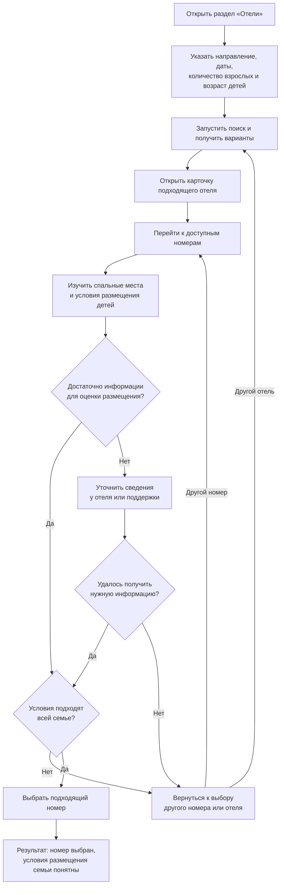

# Лабораторная работа № 1. JTBD и пользовательские сценарии

## 1. Выбор и описание веб-сервиса

Для выполнения лабораторной работы выбран веб-сервис [Яндекс Путешествия](https://travel.yandex.ru/). Это сервис для планирования поездок, который позволяет искать и бронировать жильё, а также покупать авиа- и железнодорожные билеты.

В данной работе рассматривается раздел «Отели»: поиск и выбор отеля и номера для поездки. Пользователь указывает направление, даты проживания и состав гостей, после чего получает доступные варианты размещения. Чтобы выбрать подходящий вариант, пользователь может использовать фильтры, посмотреть расположение отеля на карте, изучить фотографии, отзывы и условия проживания.

Основная задача сервиса в рамках выбранного направления — помочь пользователю найти и забронировать жильё, которое соответствует его бюджету, цели поездки и требованиям к проживанию. Например, пользователю может быть важно остановиться рядом с местом работы, выбрать отель для отдыха с детьми или найти недорогой номер на несколько ночей.

## 2. Сегменты целевой аудитории

Для анализа выбраны три сегмента пользователей.

| Сегмент | Задача пользователя | Особенности  |
| --- | --- | --- |
| Туристы, путешествующие самостоятельно или парой, без детей | Найти жильё для отдыха с подходящим соотношением цены, расположения и комфорта. | Могут сравнивать несколько отелей по стоимости, близости к достопримечательностям, фотографиям и отзывам. Выбор связан с планами на отдых и доступным бюджетом. |
| Люди, путешествующие по работе | Найти жильё на даты командировки, удобное для выполнения рабочих задач. | Могут начинать выбор с расположения относительно места работы или встречи, затем проверять стоимость, доступ к интернету и возможность получить отчётные документы. Важно учесть рабочее расписание и требования к возмещению расходов. |
| Семьи с детьми | Найти жильё, в котором смогут удобно разместиться взрослые и дети. | При поиске необходимо учитывать количество и возраст детей. При выборе номера могут быть важны спальные места для всех гостей, условия размещения детей, питание и удобства для семейного отдыха. Низкой цены или удобного расположения может быть недостаточно, если номер не подходит по составу гостей. |

Таким образом, туристы без детей могут выбирать жильё прежде всего с учётом планов на отдых, командировочные — расположения и рабочих условий, а семьи с детьми — возможности подходящего размещения всей семьи.

## 3. JTBD для каждого сегмента

### 1. Туристы, путешествующие самостоятельно или парой, без детей

1. Когда я еду на несколько дней в незнакомый город, я хочу найти жильё рядом с местами, которые планирую посетить, чтобы меньше времени тратить на дорогу и больше успеть посмотреть.
2. Когда я планирую отпуск с ограниченным бюджетом, я хочу подобрать подходящее жильё с понятной полной стоимостью проживания, чтобы уложиться в бюджет.

### 2. Люди, путешествующие по работе

1. Когда я еду в командировку со встречами рано утром, я хочу остановиться недалеко от места их проведения, чтобы успеть отдохнуть и приходить на встречи вовремя.
2. Когда работодатель возмещает расходы на проживание в пределах установленной суммы, я хочу найти жильё в рамках этого ограничения с возможностью получить необходимые отчётные документы, чтобы подтвердить расходы и получить возмещение.

### 3. Семьи с детьми

1. Когда я планирую поездку с детьми, я хочу найти номер с подходящими спальными местами для всех членов семьи, чтобы мы могли разместиться вместе и полноценно отдыхать.
2. Когда я еду на отдых с маленьким ребёнком, я хочу выбрать жильё с подходящими условиями для его питания и дневного сна, чтобы сохранять привычный режим ребёнка во время поездки.

## 4. User stories и критерии приёмки

### 1. Поиск жилья на даты поездки

Как пользователь, планирующий поездку, я хочу указать направление, даты проживания и состав гостей, чтобы найти жильё, доступное и подходящее для моей поездки.

Критерии приёмки:

- Пользователь может указать направление, даты заезда и выезда, количество взрослых и детей, а также возраст каждого ребёнка.
- После запуска поиска отображаются варианты размещения для заданных дат и состава гостей. Выбранные параметры остаются видны на странице результатов.
- Если дата выезда не позже даты заезда, поиск не запускается и пользователь получает сообщение о необходимости исправить даты.
- Если подходящих вариантов нет, отображается сообщение об отсутствии результатов и возможность изменить параметры поиска.

### 2. Выбор жилья по расположению

Как турист или человек в командировке, я хочу посмотреть расположение отелей на карте относительно интересующего меня места, чтобы выбрать жильё, из которого удобно добираться до запланированных мест посещения или работы.

Критерии приёмки:

- Пользователь может открыть карту с расположением найденных вариантов размещения.
- При выборе отеля на карте отображаются его название и стоимость проживания на выбранные даты, доступен переход к подробной информации.
- При переходе с карты к информации об отеле сохраняются даты проживания и состав гостей.

### 3. Ограничение стоимости поиска

Как турист с ограниченным бюджетом или сотрудник с установленным лимитом расходов, я хочу ограничить стоимость найденных вариантов, чтобы выбирать среди предложений, которые могу себе позволить.

Критерии приёмки:

- Пользователь может задать верхнюю границу стоимости. Рядом указано, относится сумма к одной ночи или ко всему периоду проживания.
- После применения ограничения отображаются только предложения, стоимость которых не превышает заданную границу по указанному правилу расчёта.
- Если предложений в заданном диапазоне нет, пользователь видит сообщение об отсутствии результатов и может изменить или сбросить ограничение.

### 4. Проверка полной стоимости проживания

Как пользователь, выбирающий жильё в рамках бюджета, я хочу узнать полную стоимость выбранного варианта и обязательные дополнительные платежи до подтверждения бронирования, чтобы заранее оценить расходы на проживание.

Критерии приёмки:

- Для выбранного номера и тарифа отображается итоговая стоимость на весь период проживания с учётом указанного состава гостей.
- Обязательные дополнительные платежи, если они есть, указаны отдельно с пояснением, входят ли они в итоговую сумму и когда оплачиваются.
- При изменении дат, состава гостей или тарифа стоимость пересчитывается до подтверждения бронирования.

### 5. Проверка условий получения отчётных документов

Как человек, путешествующий по работе, я хочу до бронирования узнать, какие документы о проживании смогу получить и как их получить, чтобы убедиться, что смогу подтвердить расходы перед работодателем.

Критерии приёмки:

- До подтверждения бронирования пользователь может ознакомиться с перечнем предоставляемых документов, порядком их получения и информацией о том, кто их выдаёт.
- Если нужные сведения отсутствуют, это явно указано и пользователю доступен способ уточнить их у отеля или поддержки сервиса.

### 6. Проверка спальных мест для семьи

Как родитель, путешествующий с детьми, я хочу узнать количество и тип спальных мест в конкретном номере и условия размещения детей, чтобы вся семья могла разместиться вместе и удобно отдыхать.

Критерии приёмки:

- В описании выбранного варианта размещения указаны количество и тип основных спальных мест, а также допустимое число гостей.
- Если для размещения семьи требуется дополнительная или детская кровать, указаны условия её предоставления, стоимость и необходимость предварительного согласования.
- Если сведения о спальных местах или размещении детей не указаны, пользователь видит, что их нужно уточнить, и может связаться с отелем или поддержкой до бронирования.

## 5. Флоу приоритетной user story

Для построения флоу выбрана история «Проверка спальных мест для семьи»:

> Как родитель, путешествующий с детьми, я хочу узнать количество и тип спальных мест в конкретном номере и условия размещения детей, чтобы вся семья могла разместиться вместе и удобно отдыхать.

Эта история выбрана приоритетной для сегмента семей с детьми: наличие свободного номера ещё не означает, что он подходит для размещения всей семьи. До бронирования пользователю необходимо проверить спальные места и условия проживания детей.

Начало сценария — поиск жилья для семейной поездки. Результат — выбран номер, для которого понятны и подходят условия размещения всех членов семьи.

При оценке номера пользователь проверяет количество и тип основных спальных мест, допустимый состав гостей и условия размещения детей. Если требуется дополнительная или детская кровать, он также уточняет возможность её предоставления, доплату и необходимость предварительного согласования. Если предоставление такой кровати не подтверждено, пользователь возвращается к выбору других вариантов.

## 6. KPI для выбранного JTBD

Выбранный JTBD:

> Когда я планирую поездку с детьми, я хочу найти номер с подходящими спальными местами для всех членов семьи, чтобы мы могли разместиться вместе и полноценно отдыхать.

**KPI — доля поисковых сессий с детьми, завершившихся подтверждённым бронированием номера для указанного состава гостей.**

Формула расчёта:

**KPI = (Количество сессий с поиском жилья с детьми и подтверждённым бронированием / Общее количество сессий с поиском жилья с детьми) × 100%.**

Поиск жилья с детьми считается начатым после отправки поискового запроса, в котором указан хотя бы один ребёнок. В числителе учитываются сессии, в которых после такого поиска пользователь получил подтверждение бронирования на указанный состав гостей. Каждая сессия учитывается один раз, независимо от количества повторных поисков и бронирований.

Показатель позволяет оценить, какая доля семейных поисков завершается результатом — подтверждённым бронированием. Он связан с задачей найти жильё для всей семьи: пользователь выбирает подходящий вариант и оформляет проживание на указанный состав гостей. Проверка спальных мест, показанная во флоу в пункте 5, является одним из этапов этого пути.

При анализе важно учитывать, что на показатель также могут влиять цены, наличие номеров и условия оплаты. Его изменение само по себе не объясняет причину затруднений при выборе жилья.

## 7. Альтернативный путь

Для user story «Проверка спальных мест для семьи» можно рассмотреть два пути: выбор отеля через список результатов и выбор через карту. В обоих случаях цель пользователя — найти номер с подходящими спальными местами и понятными условиями размещения всей семьи.

**Основной путь — через список результатов:**

Указать направление, даты и состав семьи → запустить поиск → просмотреть список отелей → открыть карточку подходящего отеля → перейти к номерам → проверить спальные места и условия размещения детей → выбрать подходящий номер.

**Альтернативный путь — через карту:**

Указать направление, даты и состав семьи → запустить поиск → открыть карту результатов → найти удобный район и выбрать отель на карте → открыть его карточку → перейти к номерам → проверить спальные места и условия размещения детей → выбрать подходящий номер.

Основной путь удобен, когда пользователь хочет сначала сравнить предложения из списка по цене и общей информации об отелях. Альтернативный путь может быть удобнее, если для семьи особенно важно расположение, например рядом с пляжем, парком или местом отдыха.

Пути различаются способом выбора отеля. Оба приводят к проверке конкретного номера: пользователь оценивает спальные места, условия проживания детей и при необходимости уточняет сведения у отеля или поддержки. Результат в обоих случаях — выбор номера, который подходит всей семье.
