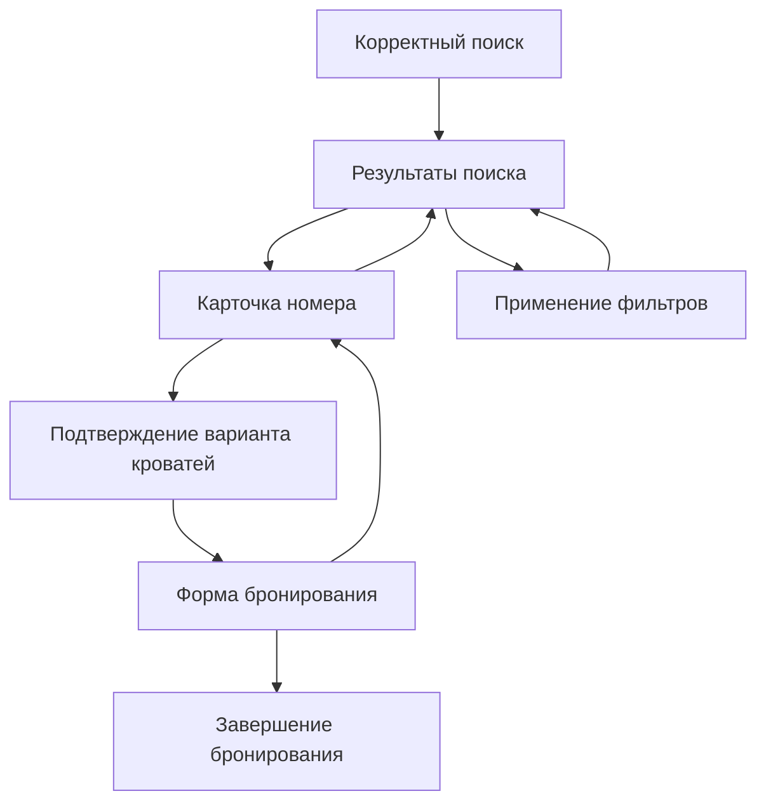

# Лабораторная работа № 3. Аналитика и KPI

[Открыть интерфейс](/hci-labs/booking/)

## 1. Выберите сценарий и реализуйте его

**Сценарий:** поиск и бронирование одного номера для двух взрослых и двух детей с подходящими спальными местами.

**Целевая аудитория:** семьи с детьми, самостоятельно планирующие поездку.

**Задача пользователя:** выбрать номер, в котором вся семья сможет разместиться вместе, каждому ребёнку хватит отдельной обычной кровати.

**Задание для участника**

> Вы планируете поездку с семьёй: двое взрослых и двое детей. Найдите и оформите один номер для всей семьи. Каждому ребёнку нужна отдельная обычная кровать — двухъярусные кровати, диваны и дополнительные кровати не подходят. Город, даты поездки и возраст детей выберите самостоятельно. В форме бронирования можно использовать вымышленные имя и электронную почту.

**Ожидаемый результат:** открыт экран завершения бронирования одного номера для двух взрослых и двух детей. В подтверждении сохранены выбранные параметры поездки, подходящие кровати и итоговая стоимость. Подходят одна двуспальная и две односпальные кровати либо четыре односпальные кровати.

Во второй лабораторной семейный сценарий удалось пройти в обоих сервисах. При этом возникали затруднения, связанные с количеством номеров, спальными местами и условиями цены.

| Наблюдение во второй лабораторной | Решение в интерфейсе |
| --- | --- |
| В Яндекс Путешествиях при поиске одного номера встречались предложения двух отдельных номеров. Их приходилось исключать при просмотре | В выдаче предлагается один номер для всех гостей. Если подходящего варианта нет, показано сообщение с предложением рассмотреть два отдельных номера, если семье подходит раздельное размещение |
| Состав кроватей и количество основных мест проверялись на разных экранах | В выдаче указаны количество и тип кроватей, число мест; диван и дополнительная кровать названы отдельно |
| На Островке встречались тарифы для четырёх гостей, в кратком описании которых была указана только двуспальная кровать | У каждого варианта размещения приведён полный состав спальных мест |
| Выбранный состав гостей не избавлял от проверки того, как именно разместится семья | Добавлены фильтры «Без двухъярусных кроватей», «Без диванов», «Без дополнительных кроватей» |
| Для проверки стоимости требовалось уточнять условия тарифа | В карточке указана сумма за весь период; в подробностях и при оформлении показаны включённые доплаты |

Основная гипотеза: когда количество и тип кроватей видны сразу в карточке, пользователю проще понять, подходит ли номер для всей семьи. Это позволит реже переходить между экранами для уточнения спальных мест и снизит вероятность ошибки при выборе номера.

В каталоге 12 предложений номеров. Они различаются стоимостью, составом кроватей, питанием и условиями отмены. Есть варианты с двумя двуспальными, четырьмя односпальными, двуспальной и двумя односпальными кроватями, а также с двухъярусной кроватью, диваном и дополнительной кроватью. У части номеров можно выбрать один из нескольких вариантов кроватей.

| Экран | Содержание |
| --- | --- |
| **Поиск** | Город, даты заезда и выезда, состав гостей. Количество взрослых и возраст детей задаются в выпадающей панели |
| **Результаты** | Карточки номеров с составом кроватей и полной стоимостью. Рядом расположены фильтры бюджета, спальных мест, питания и отмены. Параметры поездки можно изменить над выдачей |
| **Карточка номера** | Выбор конкретного варианта кроватей, описание номера, питание, отмена, расчёт стоимости |
| **Бронирование** | Имя и электронная почта гостя; рядом — даты, состав гостей, выбранные кровати и итоговая сумма. Ошибки показаны у соответствующих полей |
| **Подтверждение** | Сообщение об оформлении и сведения о выбранном номере, датах, гостях, кроватях и стоимости |

Выбранный вариант кроватей сохраняется при переходе к форме, возврате к описанию и успешном завершении. Фильтры исключают неподходящие варианты кроватей. Если у номера остаётся хотя бы один подходящий вариант, карточка сохраняется в выдаче.

*Рисунок 1 — Поиск жилья: город, даты и гости собраны в компактной строке.*

*Рисунок 2 — Результаты после применения бюджета 36 000 ₽ и исключения двухъярусных кроватей, диванов и дополнительных кроватей.*

*Рисунок 3 — В подробностях номера выбран вариант с одной двуспальной и двумя односпальными кроватями; выбор отображается в сводке поездки.*

*Рисунок 4 — Пустую форму нельзя отправить: у полей имени и электронной почты показаны сообщения об ошибках.*

*Рисунок 5 — Подтверждение содержит выбранный состав кроватей и итоговую стоимость проживания.*

## 2. KPI до сбора данных

**Основной KPI**

**Доля сессий, в которых начатый поиск завершился успешным бронированием.**

  KPI =
  SзавершилиSначали
  × 100%

- **Sначали** — число сессий с событием `search_started`.
- **Sзавершили** — число этих сессий, в которых после поиска произошло `booking_completed`.

Началом поиска считается нажатие «Найти» при корректных датах. Завершением считается отправка корректной формы и появление экрана подтверждения. Нажатие на кнопку с ошибками в форме не засчитывается как завершение.

Показатель связан с JTBD: он позволяет оценить, какая доля начавших выбор жилья проходит до оформления. Повторные поиски и возвраты внутри одной сессии не увеличивают число сессий в расчёте.

**Вспомогательные показатели**

| Показатель | Расчёт | Для чего нужен |
| --- | --- | --- |
| **Доля завершённых бронирований, соответствующих заданию** | Сессии с первым `booking_completed`, у которого `task_match = true`, / все сессии с `booking_completed` после начала поиска × 100% | Показывает, удалось ли выбрать подходящие кровати и размещение всей семьи в одном номере |
| **Медианное время до завершения** | Медиана `duration_seconds` у первых завершённых бронирований в сессиях с начатым поиском | Позволяет оценить, сколько времени занимает весь путь от первого корректного поиска до подтверждения |

`task_match` проверяет состав гостей и спальные места из раздела 1. Конкретные город, даты, возраст детей и бюджет не заданы и не влияют на эту оценку. Для спальных мест подходят варианты `mixed` и `single`; остальные варианты не соответствуют требованию отдельной обычной кровати каждому ребёнку.

Для расчётов используется первое завершение в сессии. Если после неудачного выбора пользователь возвращается и пробует другой номер, это можно рассмотреть по последовательности действий и наблюдениям, но первое завершение не заменяется более удачным.

Сессии без завершения включаются в знаменатель основного KPI, но не в расчёт времени до завершения. Если начатых поисков или завершений нет, соответствующий показатель не рассчитывается: отсутствие данных не приравнивается к 0% или нулевому времени.

## 3. Тачпойнты пользовательского сценария

Основной путь:

Фильтры помогают выбрать номер, но не обязательны для завершения сценария. Поэтому применение фильтров рассматривается отдельно и не включается в основную воронку как обязательный шаг.

| Шаг | Событие | Что означает переход |
| --- | --- | --- |
| **1. Начало поиска** | `search_started` | Пользователь запустил поиск с корректными параметрами |
| **2. Просмотр результатов** | `results_viewed` | Выдача отобразилась после поиска |
| **3. Просмотр номера** | `room_viewed` | Пользователь открыл подробности предложения |
| **4. Подтверждение кроватей** | `beds_confirmed` | Пользователь перешёл к оформлению с конкретным вариантом кроватей |
| **5. Начало оформления** | `booking_started` | Форма бронирования открылась |
| **6. Завершение** | `booking_completed` | Корректная форма отправлена, показано подтверждение |

Начало поиска и отображение результатов, а также подтверждение кроватей и открытие формы происходят почти подряд. Потери между ними могут указывать на техническую проблему перехода. Для анализа выбора номера важен переход от результатов к карточке, для анализа оформления — от формы к завершению.

## 4. События

В код добавлены девять событий. Они отмечают продвижение по сценарию и действия, которые помогут объяснить остановки пользователя.

| Событие | Когда возникает | Параметры |
| --- | --- | --- |
| **`interface_opened`** | Первое открытие интерфейса в сессии | Без дополнительных параметров |
| **`search_started`** | Отправка корректной формы поиска | `night_count`, `guest_count` |
| **`results_viewed`** | Открытие экрана результатов | `result_count` |
| **`filters_applied`** | Применение или сброс фильтров | `noBunk`, `noSofa`, `noExtra`, `breakfast`, `cancellation`, `budget_limit` |
| **`room_viewed`** | Открытие подробностей номера | `room_id` |
| **`beds_confirmed`** | Переход к бронированию с выбранными кроватями | `room_id`, `bed_variant` |
| **`booking_started`** | Открытие формы бронирования | `room_id`, `bed_variant` |
| **`form_error`** | Попытка отправить форму с ошибками | `form`, `fields` |
| **`booking_completed`** | Первое успешное завершение в сессии | `room_id`, `bed_variant`, `total_price`, `task_match`, `duration_seconds` |

У фильтра без ограничения бюджета `budget_limit` равен `-1`. У `form_error` передаются названия формы и ошибочных полей, но не введённые значения. Имя и электронная почта не включены в параметры событий.

Событие `beds_confirmed` возникает и для номера с единственным вариантом кроватей: переход к форме означает подтверждение указанного варианта. Изменение переключателя само по себе не считается завершением выбора.

Локальный журнал хранится в `sessionStorage` текущей вкладки. После 30 минут без событий начинается новая локальная сессия. Журнал нужен для проверки срабатываний; он не объединяет данные с устройств участников и не заменяет счётчик аналитики.

Для передачи событий выбрана [Яндекс Метрика](https://metrika.yandex.ru/). Подготовлены [код событий](/hci-labs/assets/booking/analytics.js) и [настройка счётчика](/hci-labs/assets/booking/analytics-config.js). Для каждого события предусмотрен вызов `ym(номер_счётчика, 'reachGoal', идентификатор, параметры)` согласно [официальной документации](https://yandex.ru/support/metrica/ru/objects/reachgoal.html).

**Счётчик ещё не создан.** В настройке `metrikaCounterId` указан `0`, поэтому библиотека Метрики не загружается и события во внешний счётчик не отправляются. Сейчас можно проверить только локальную регистрацию событий.

**Что потребуется для подключения**

1. Создать счётчик в Яндекс Метрике для опубликованного сайта и указать его номер в `metrikaCounterId`.
2. Создать девять целей типа «Целевое событие», используя идентификаторы из раздела 4. [Инструкция по настройке целей](https://yandex.ru/support/metrica/ru/general/goal-js-event).
3. Открыть интерфейс, пройти сценарий и убедиться, что события поступили в счётчик. [Инструкция по проверке целей](https://yandex.ru/support/metrica/ru/general/check-goal).
4. Перед приглашением участников удалить или исключить проверочные визиты из анализа.

Передачу событий в Метрику можно считать настроенной только после проверки их поступления в созданный счётчик. Локальное появление названия события этого не доказывает.

## 5. Данные

Данные участников пока не собраны.

Планируется собрать ориентировочно 15–20 пользовательских сессий после публикации интерфейса и подключения счётчика. Каждому участнику выдаётся одинаковое задание из раздела 1. Во время прохождения не подсказывается, какие фильтры или кнопки использовать.

## 6. Воронка

Для каждого шага учитывается количество сессий, дошедших до него после предыдущих шагов. Повторное открытие одного экрана не считается новой сессией. Если пользователь пропускает необязательные фильтры, он остаётся в основной воронке.

  Ci =
  NiNi − 1
  × 100%

  Li =
  Ni − 1 − NiNi − 1
  × 100%

Здесь **Ci** — конверсия шага, **Li** — потери, **Ni** — число сессий на текущем шаге, **Ni − 1** — на предыдущем.

Потери рассчитываются относительно предыдущего шага. Значения воронки будут добавлены после прохождений участников.

Для анализа основного KPI в Метрике нужно отобрать визиты, в которых был корректно начат поиск, и определить долю визитов с завершением после него. Каждому участнику предлагается одно прохождение в одной вкладке. Локальные сессии и визиты Метрики могут иметь разные границы; их нельзя объединять в одну выборку без сопоставления. Для итоговых значений используется один источник — Метрика.

## 7. Причина потерь

До сбора данных рассматриваются три возможные причины затруднений:

1. **Пользователь не замечает, какой вариант кроватей выбран.** Он может просмотреть доступные варианты, но перейти к бронированию с вариантом, выбранным по умолчанию.
2. **Фильтры требуют исключать неподходящие типы спальных мест.** Чтобы оставить обычные кровати, нужно отметить несколько условий: без диванов, двухъярусных и дополнительных кроватей. Пользователю может быть сложно сразу определить, какие ограничения нужны.
3. **Состав кроватей приходится сопоставлять с потребностями семьи.** Например, две двуспальные кровати вмещают четверых, но не соответствуют условию отдельной кровати каждому ребёнку. Пользователь может ориентироваться на общее число мест и выбрать неподходящий вариант.

Это гипотезы. После прохождений нужно проверить, возникали ли такие затруднения и приводили ли они к остановке сценария или ошибочному выбору номера.

## 8. Свяжите проблемный шаг с KPI

Расчёт по результатам прохождений пока не выполнялся.

Для оценки возможного эффекта используется расчётная гипотеза. Если доля сессий, дошедших до проблемного перехода, равна `a`, его текущая конверсия — `p`, предполагаемая новая — `q`, а доля завершений после этого перехода — `r`, то:

  ΔKPI = a × (q − p) × r × 100 п.п.

В формуле доли задаются числами от 0 до 1. Расчёт предполагает, что остальные переходы не изменились. Он показывает возможный эффект при заданных условиях и не заменяет проверку изменения на пользователях.

## 9. Предложения по улучшению

На основе трёх гипотез из пункта 7 предложены следующие изменения. Пока это предложения: они не реализованы и не проверены на участниках.

| Возможное затруднение | Предлагаемое изменение | Локальная метрика | Связь с KPI |
| --- | --- | --- | --- |
| Пользователь переходит дальше с вариантом кроватей, выбранным по умолчанию | Для номеров с несколькими вариантами убрать выбор по умолчанию. Перед переходом к форме предложить явно выбрать состав кроватей | Доля завершённых бронирований с неподходящим составом кроватей | Явный выбор может повысить долю бронирований, соответствующих заданию. Дополнительное действие может повлиять на основную конверсию, поэтому нужно проверить, не увеличатся ли потери перед формой |
| Чтобы оставить обычные кровати, нужно отметить несколько исключений | Добавить фильтр «Только обычные кровати», который исключает двухъярусные кровати, диваны и дополнительные места | Доля сессий с повторным изменением фильтров | Более простой выбор условий может сократить возвраты к фильтрам и повысить долю пользователей, дошедших от поиска до бронирования |
| Пользователь путает число мест и количество кроватей | В карточке отдельно показывать количество кроватей и мест: например, «3 кровати · 4 места», затем состав кроватей | Доля завершённых бронирований, соответствующих заданию | Сведения могут помочь избежать ошибочного выбора и повторного поиска. Это должно повысить долю правильных бронирований и может увеличить основную конверсию за счёт сокращения возвратов |

После сбора данных нужно проверить, возникали ли описанные затруднения. Предложения следует уточнить по наблюдениям и сравнить показатели до и после изменения. Численный эффект пока не оценивался.

**Ограничения анализа.**

При интерпретации будущих результатов нужно учитывать небольшой учебный каталог, отсутствие реальной оплаты и возможный опыт участников в подобных сервисах. Самостоятельный выбор города, дат и возраста детей может влиять на время прохождения. Если участник дополнительно ограничивает бюджет, это влияет на количество подходящих предложений. Это нужно учитывать при сравнении участников. Общее время прохождения не включает загрузку большого реального каталога или проверку платежа. Выводы по небольшой выборке будут относиться к этому сценарию и не смогут характеризовать всех пользователей.

**Итоговые выводы.**

Реализован законченный путь поиска и бронирования семейного номера. Добавлены фильтры спальных мест, выбор варианта кроватей и его сохранение до подтверждения. Заранее определены основной KPI, два вспомогательных показателя и девять событий.

Данные участников и результаты их анализа пока пропущены. Счётчик Метрики ещё не создан, публичная версия третьей лабораторной не опубликована. Сейчас нельзя утверждать, что интерфейс эффективнее Яндекс Путешествий или Островка.
